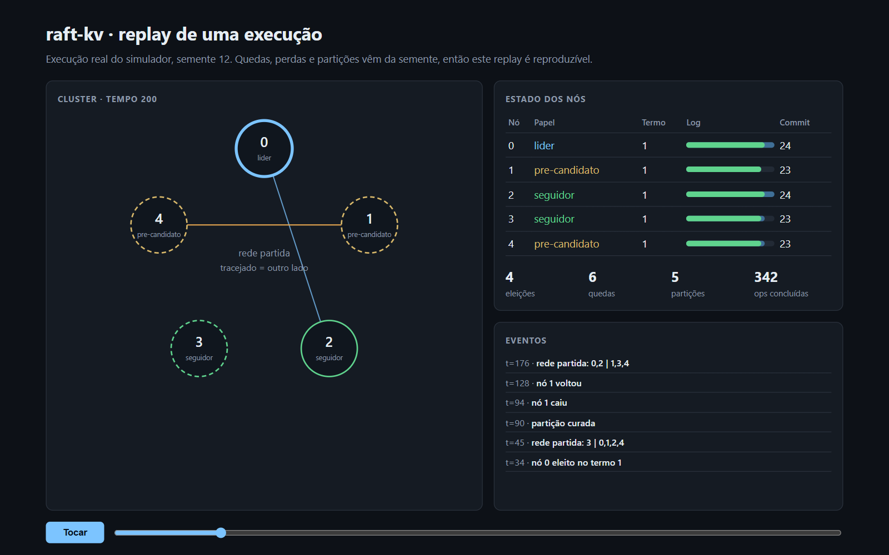
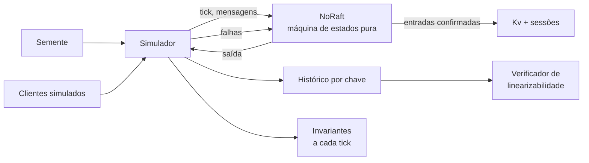

# raft-kv

Banco chave-valor replicado com consenso Raft, testado por simulação determinística e verificação formal de linearizabilidade. TypeScript, Node 24, zero dependências.

[](https://github.com/luizrenatodc/raft-kv/actions/workflows/testes.yml)
[](LICENSE)

**[Abrir o replay interativo](https://luizrenatodc.github.io/raft-kv/)** de uma execução real, com quedas e partições.



## Por que este projeto existe

Implementar Raft é a parte fácil. Difícil é ter evidência de que a implementação continua correta quando a rede perde mensagens, um nó cai no meio de uma eleição e uma partição cura fora de ordem. Testes de exemplo não alcançam esses casos.

Por isso o foco aqui é a verificação: o algoritmo é uma máquina de estados pura, executada em um simulador que controla relógio, rede e falhas a partir de uma semente, e cada histórico produzido passa por um verificador de linearizabilidade.

## O que está implementado

| Área | Detalhe |
|---|---|
| Eleição | Prazos aleatórios e pré-voto, para um nó isolado não derrubar um líder saudável ao voltar |
| Replicação | Lotes, recuo rápido por termo em conflito, truncamento só em conflito real |
| Commit | Regra da Figura 8: o líder só confirma por contagem entradas do próprio termo |
| Leitura | ReadIndex: confirma a liderança com um quórum antes de responder |
| Clientes | Sessões replicadas dão execução única, mesmo quando o pedido é repetido |
| Operações | `set` e `cas` (compare-and-swap), com leitura linearizável |

## Arquitetura



| Arquivo | Responsabilidade |
|---|---|
| [`src/raft.ts`](src/raft.ts) | Protocolo. Não conhece relógio, rede nem disco |
| [`src/kv.ts`](src/kv.ts) | Máquina de estados replicada e sessões de cliente |
| [`src/simulador.ts`](src/simulador.ts) | Rede, quedas, partições, clientes e invariantes |
| [`src/linearizabilidade.ts`](src/linearizabilidade.ts) | Verificador Wing e Gong com memoização |
| [`scripts/campanha.ts`](scripts/campanha.ts) | Gera os números desta página |

## Como a correção é verificada

Duas camadas independentes rodam em cada execução:

1. **Invariantes a cada tick:** no máximo um líder por termo, e nenhum índice aplicado com comandos diferentes em nós diferentes.
2. **Linearizabilidade de ponta a ponta:** o verificador procura uma ordem total das operações que respeite o tempo real. Operação sem resposta pode ter acontecido ou não, e o verificador considera os dois casos.

### Resultados medidos

Saída de `node scripts/campanha.ts`. Cada execução tem 3.000 ticks e 5 nós.

| Campanha | Execuções | Operações | Quedas | Partições | Violações | Não linearizáveis |
|---|---:|---:|---:|---:|---:|---:|
| Padrão (5% de perda) | 500 | 456.210 | 2.587 | 2.137 | 0 | 0 |
| Hostil (30% de perda, atraso até 25 ticks) | 200 | 44.536 | 4.903 | 2.292 | 0 | 0 |

Na campanha hostil, 95 de 600 históricos estouraram o limite de busca e ficaram **indeterminados**: o verificador não concluiu sobre eles. Nenhuma violação ali quer dizer "nenhuma encontrada nos 505 restantes", e as invariantes valeram nas 200 execuções.

### Os testes têm dentes?

Uma suíte que nunca falha não prova nada. Por isso o código aceita defeitos injetados, cada um removendo uma regra de segurança:

| Defeito injetado | Detectado? | Primeira semente | Como |
|---|---|---:|---|
| Nó esquece o voto ao cair | Sim | 10 | Dois líderes no mesmo termo |
| Voto ignora a atualização do log | Sim | 13 | Índice aplicado com comandos diferentes |
| Leitura sem confirmar quórum | Sim | 2 | Histórico não linearizável |
| Commit por contagem de termo antigo | **Não, em 300 sementes** | n/a | Ver limites |

## Como rodar

Requer Node 24 ou superior. Não há nada para instalar.

```bash
npm test                     # 12 testes, cerca de 12 segundos
SEMENTES=500 npm test        # varredura maior na primeira campanha
node scripts/campanha.ts     # números desta página, cerca de 2 minutos
node scripts/gravar.ts       # regrava o replay em docs/execucao.js
```

## Decisões técnicas

**Núcleo sem efeitos colaterais.** `NoRaft` recebe eventos e devolve mensagens. É o que torna a execução reproduzível: uma falha vira uma semente, não um relato.

**Pré-voto ligado sempre.** Custa uma ida e volta a mais na eleição e evita que um nó que saiu de uma partição force eleições desnecessárias.

**ReadIndex em vez de lease.** Leases dependem de relógios com desvio limitado. O ReadIndex custa uma rodada de batidas por leitura e não faz nenhuma suposição sobre tempo.

**Sessões dentro do estado replicado.** Se ficassem no líder, um pedido repetido após a troca de líder seria aplicado de novo.

## Limites conhecidos

- **O defeito da Figura 8 não foi detectado.** Ele exige uma sequência rara de trocas de líder, e o sorteio do simulador não a alcançou em 300 sementes. A regra está implementada, mas esta suíte não prova que ela é necessária. O próximo passo seria um cenário roteirizado que force a sequência.
- **Disco simulado.** O estado persistente é um objeto que sobrevive à queda. Não há `fsync`, escrita parcial nem corrupção.
- **Sem compactação de log nem mudança de membros.** Snapshots e `joint consensus` ficaram de fora, então o log cresce sem limite.
- **Sem transporte real.** Rodar em rede exigiria um adaptador de RPC e um disco de verdade.
- **O verificador tem limite de busca.** Históricos muito concorrentes podem terminar como indeterminados, como mostrado acima.

## Referências

- Ongaro e Ousterhout, *In Search of an Understandable Consensus Algorithm* (2014)
- Ongaro, *Consensus: Bridging Theory and Practice* (2014), para pré-voto e ReadIndex
- Wing e Gong, *Testing and Verifying Concurrent Objects* (1993)

## Sobre este projeto

Projeto de demonstração, criado para mostrar a abordagem técnica. Os dados e as cargas são simulados.

## Autor

**Luiz Renato Carvalho**, Engenheiro de Software e IA · [luizrenato.dev](https://www.luizrenato.dev) · [LinkedIn](https://linkedin.com/in/luizrenatodc)
